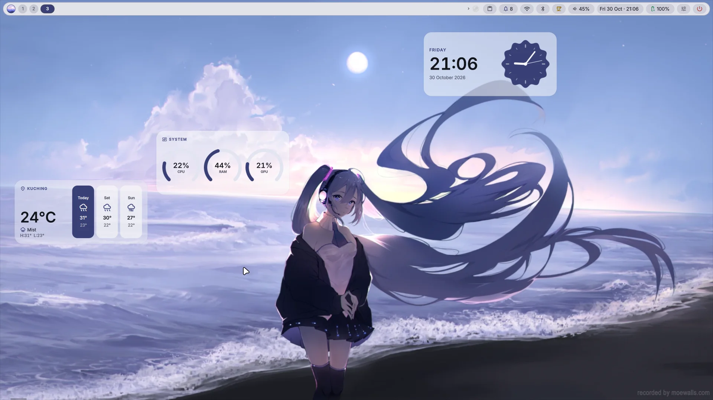
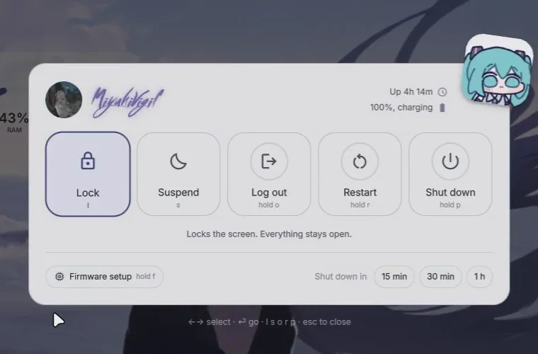
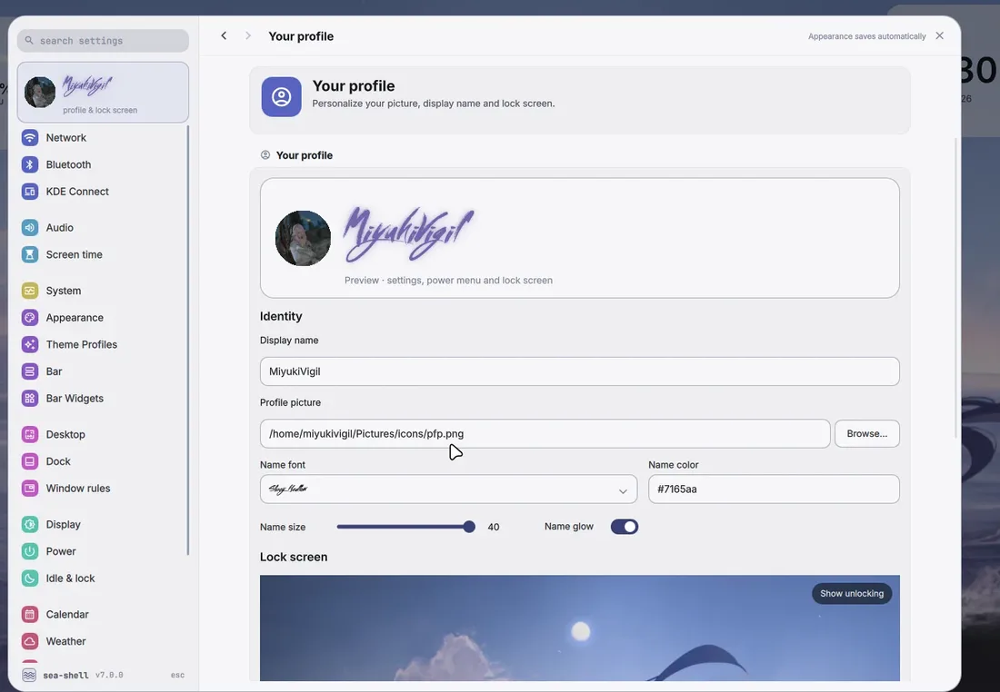
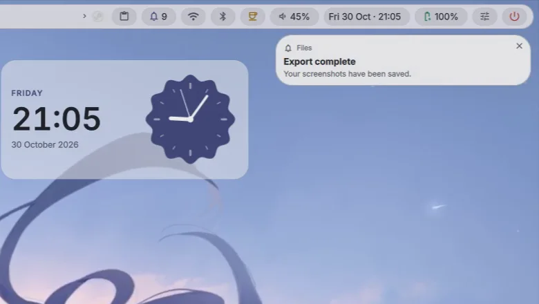
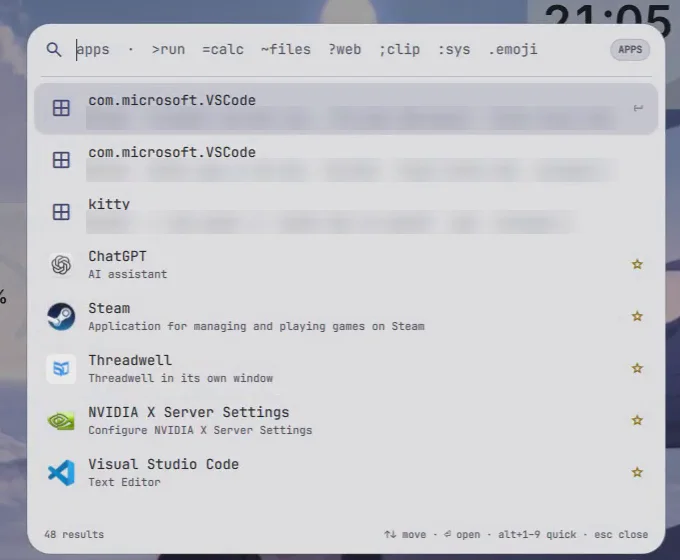
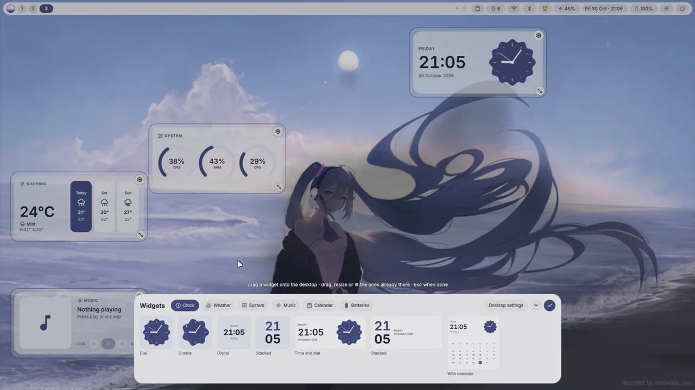
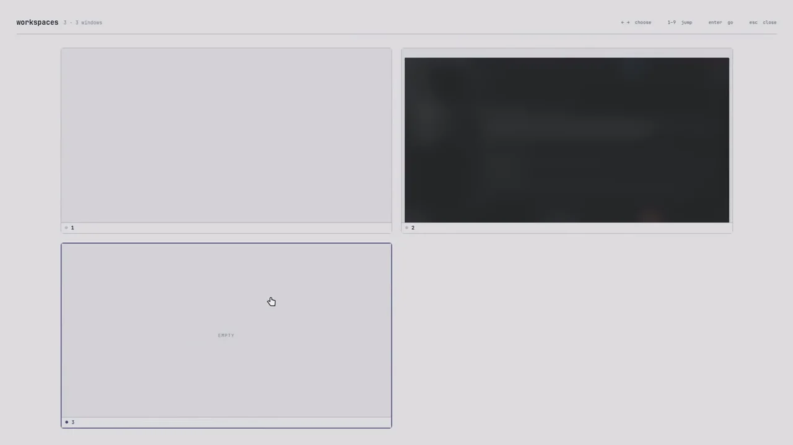
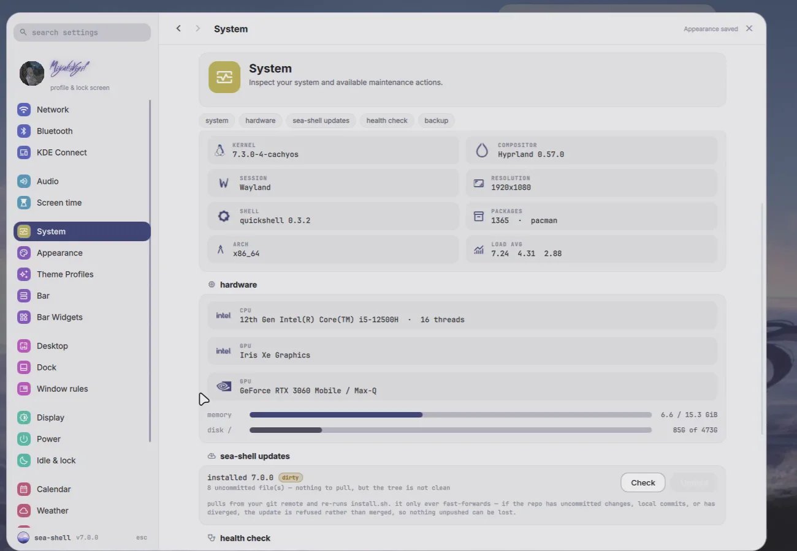
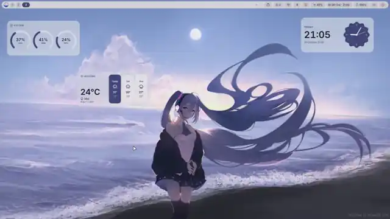

<p align="center"></p>

<h1 align="center">sea-shell</h1>

<p align="center">
A desktop for Hyprland. Bar, dock, launcher, lock screen, notifications, widgets and a control
center in one Quickshell process, coloured by your wallpaper.<br>
<b>7.0.0</b> · <a href="https://seashell.miyukivigil.tech">website</a> · <a href="CHANGELOG.md">changelog</a>
</p>



```bash
bash <(curl -fsSL https://raw.githubusercontent.com/MiyukiVigil/sea-shell/main/bootstrap.sh)
```

Use `bash <(…)`, not `curl … | bash`: the pipe takes stdin, so sudo can't ask for your password.
Built for **CachyOS / Arch · Hyprland 0.55+ · Quickshell 0.3**.

## What's in it

| | |
|---|---|
|  **Power menu** · hold to confirm, shows what will close, shutdown timers |  **Lock screen** · built in, notifications grouped by app, hyprlock as the safety net |
|  **Notifications** · its own daemon, grouped by app, mute, undo |  **Launcher** · open windows first, then apps, maths, files, clipboard, emoji |
|  **Widgets** · clock, weather, media, system, calendar, battery, placed around the wallpaper |  **Overview** · every workspace at once |


**Control center** (`SUPER+S`) · 24 pages with search, live previews, and changes that apply as you make them.


**Your wallpaper picks the colours.** matugen reads it and the bar, panels, widgets, GTK and Qt
apps, kitty and the logo all follow. Video wallpapers work too.

Also in the box: the focused window's **global menu** in the bar, a **dock**, screenshots with an
editor and OCR, a screen recorder, synced lyrics, game mode, over-the-air updates, a health check
and backups. No waybar, rofi, mako or swaync needed.

## Keys

| | |
|---|---|
| `SUPER+Space` | Launcher |
| `SUPER+S` | Control center |
| `SUPER+ESC` | Power menu |
| `SUPER+W` | Overview |
| `SUPER+V` | Clipboard history |
| `SUPER+SHIFT+A` | Arrange the desktop widgets |
| `SUPER+SHIFT+W` | Wallpaper picker |
| `SUPER+K` | Every other bind, and click one to rebind it |

## Install options

```bash
./install.sh               # packages, then configs
./install.sh --no-deps     # configs only, any distro
./install.sh --dev         # symlink to this repo while you tinker
./install.sh --uninstall   # remove it and restore what it replaced
```

Hyprland needs a Lua config (`~/.config/hypr/hyprland.lua`); see
[hypr/README-lua.md](hypr/README-lua.md) to move over from `hyprland.conf`. Every file the
installer touches is backed up first.

## Credits

Built by [MiyukiVigil](https://miyukivigil.tech), on top of:

- **[SilentSDDM](https://github.com/uiriansan/SilentSDDM)** by uiriansan, the login screen.
  Installed as `sea-silent` with sea-shell's own config; fetched from upstream at install time
  and kept under its GPL-3.0 licence.
- **[Quickshell](https://quickshell.org/)**, the toolkit the shell is written in.
- **[Hyprland](https://hypr.land/)**, the compositor.
- **[matugen](https://github.com/InioX/matugen)**, wallpaper to palette.

For EQ and DAC control, see [Hub Moon](https://hubmoon.miyukivigil.tech/).

## Licence

[MIT](LICENSE).
