<p align="center"></p>

<h1 align="center">sea-shell</h1>

<p align="center">
A desktop for Hyprland. Bar, dock, dashboard, Big Picture gaming mode, launcher, lock screen,
notifications, widgets and a 34-page control center in one Quickshell process (<code>seashell</code>,
~245 MiB idle), coloured by your wallpaper.<br>
<b>8.0.0</b> · <a href="https://seashell.miyukivigil.tech">website</a> · <a href="CHANGELOG.md">changelog</a>
</p>

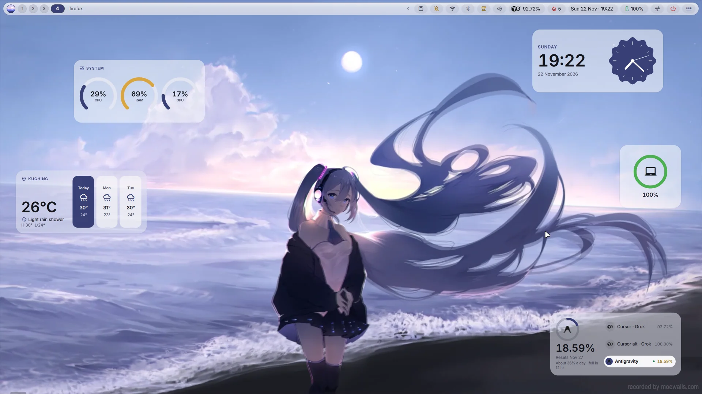

```bash
bash <(curl -fsSL https://raw.githubusercontent.com/MiyukiVigil/sea-shell/main/bootstrap.sh)
```

Use `bash <(…)`, not `curl … | bash`: the pipe takes stdin, so sudo can't ask for your password.
Built for **CachyOS / Arch · Hyprland 0.55+ · Quickshell 0.3**.

## What's in it

| | |
|---|---|
| 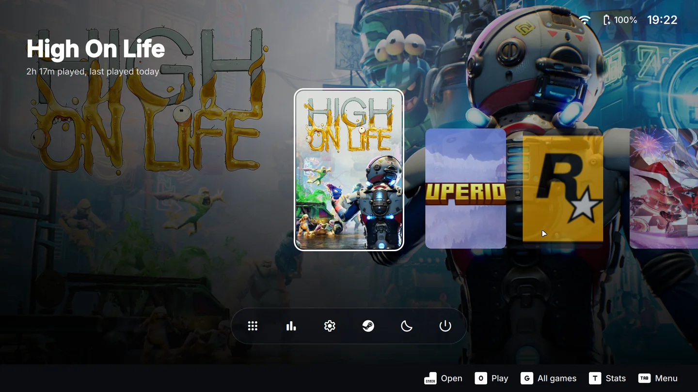 **Big Picture & Game Mode** · dedicated `sea-shell Gaming` session, Steam/Heroic/Lutris/Twintail/Prism shelf, Smart Hibernate & Ultra Zero-Shell | 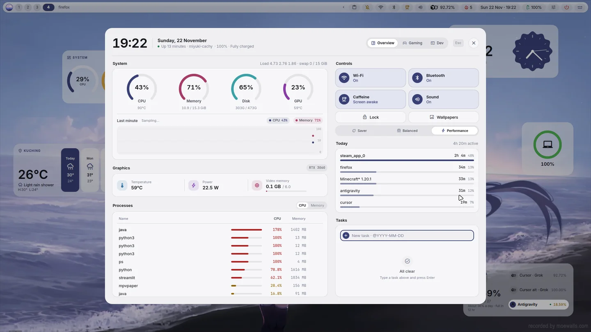 **Dashboard** · live CPU/RAM/Disk/GPU gauges, RTX telemetry, active screen time, quick controls & tasks |
| 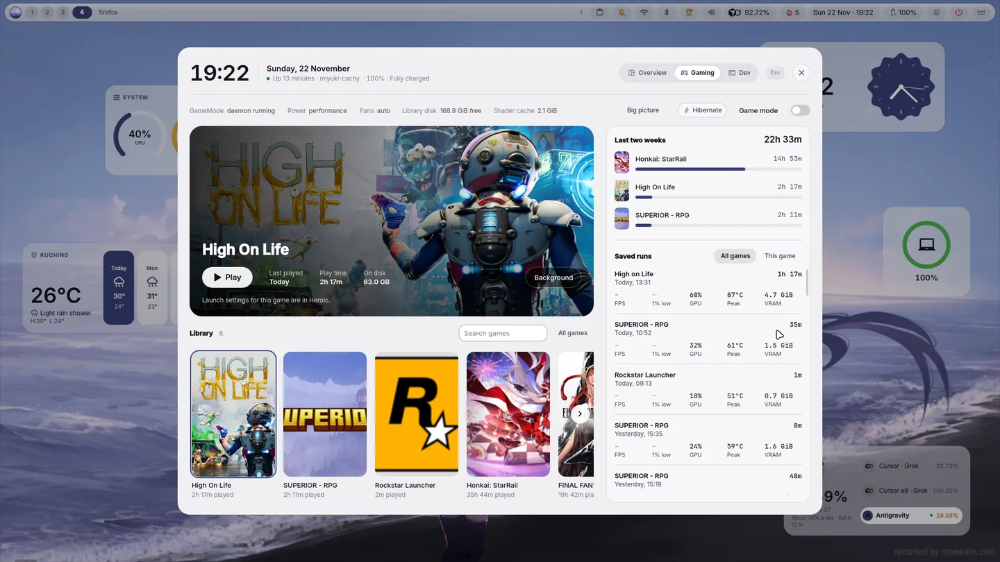 **Gaming Hub** · unified game library, shader & FPS telemetry, per-game launch options & fan profiles | 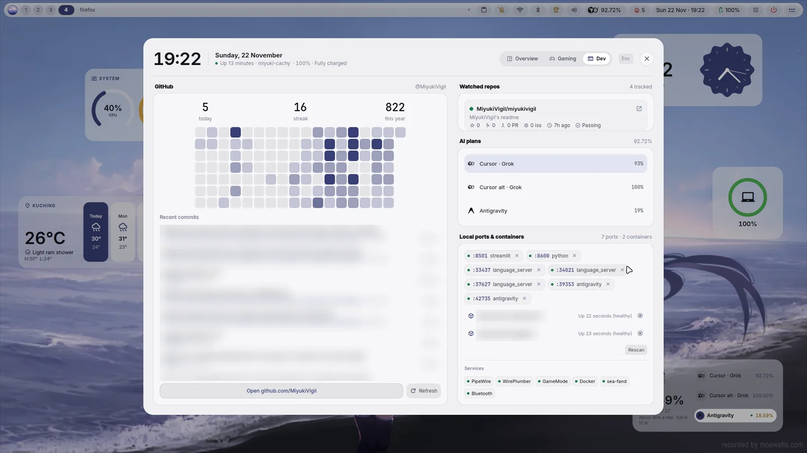 **DevHub** · GitHub contributions & commits, AI usage plans, live localhost ports, Docker containers & systemd services |
| 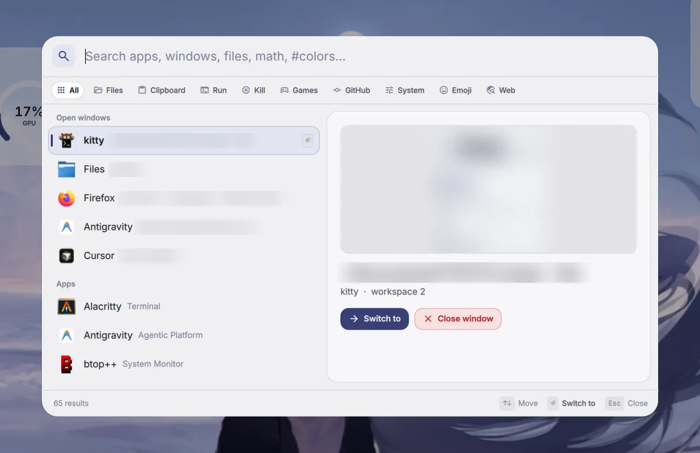 **Launcher** · open windows with live previews, apps, files, math, base/unit/tz conversions, `:kill` & `#hex` | 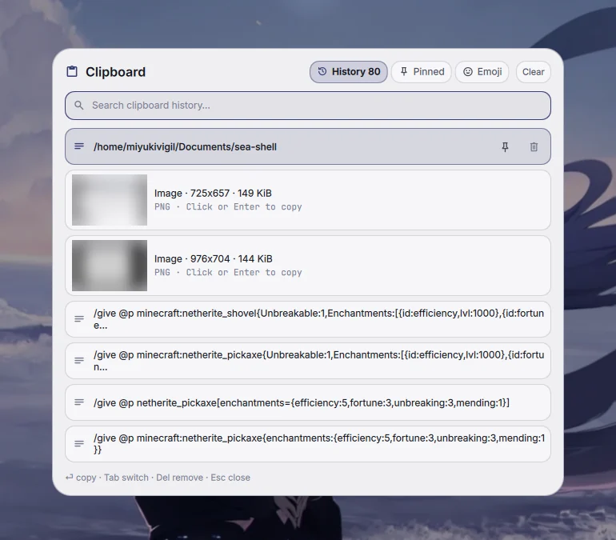 **Visual clipboard & quick overlays** · image/text history, pins, emoji, markdown notes, drop shelf QR share & Color Studio |
| 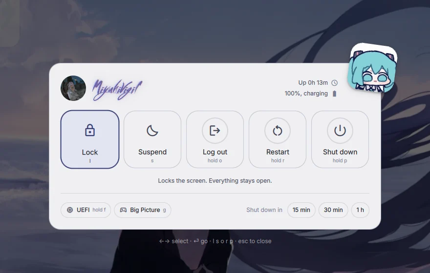 **Power menu** · hold to confirm, lists apps that will close, UEFI setup, Big Picture & shutdown timers | 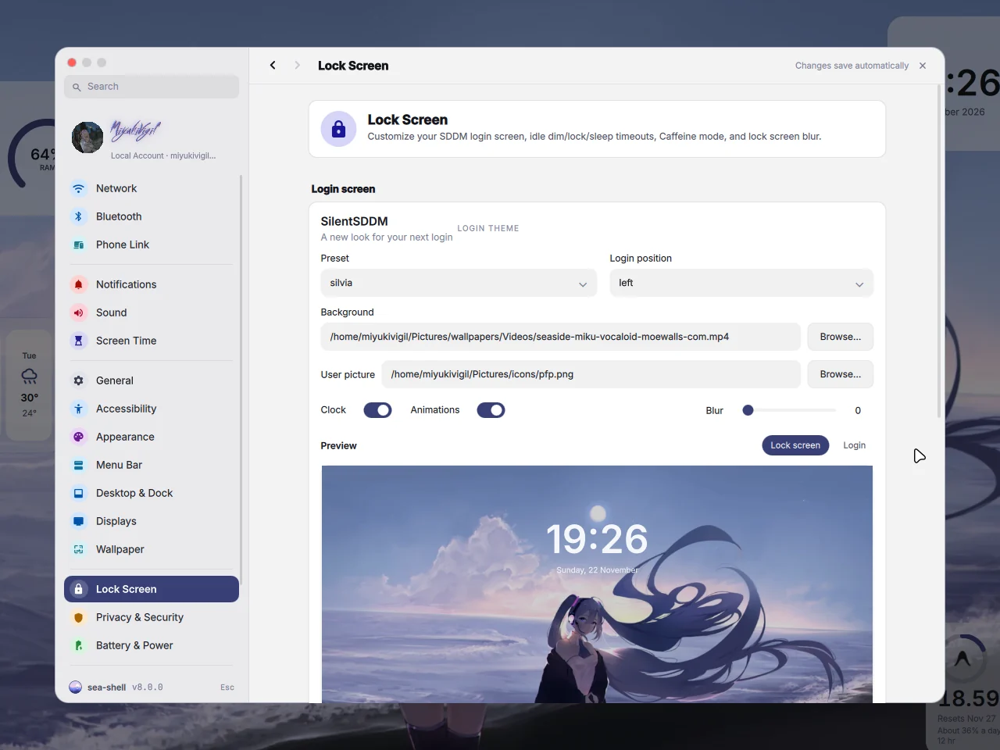 **Lock screen & SilentSDDM** · built-in lock surface with live preview, weather/events/notifications & hyprlock safety net |
| 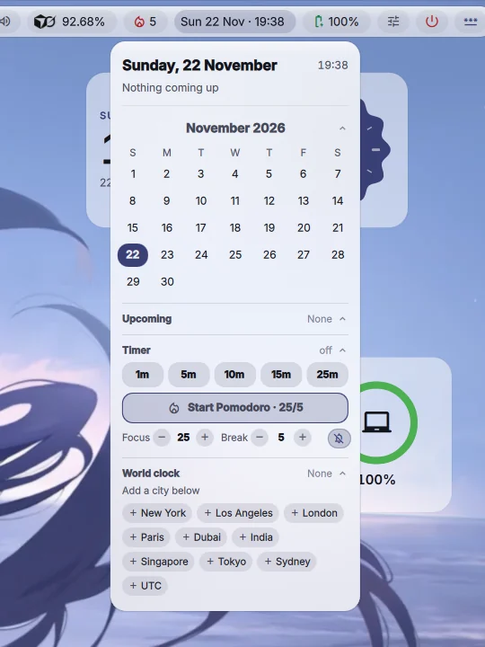 **Calendar & Timers** · monthly view, upcoming events, Pomodoro focus timer & world clock | 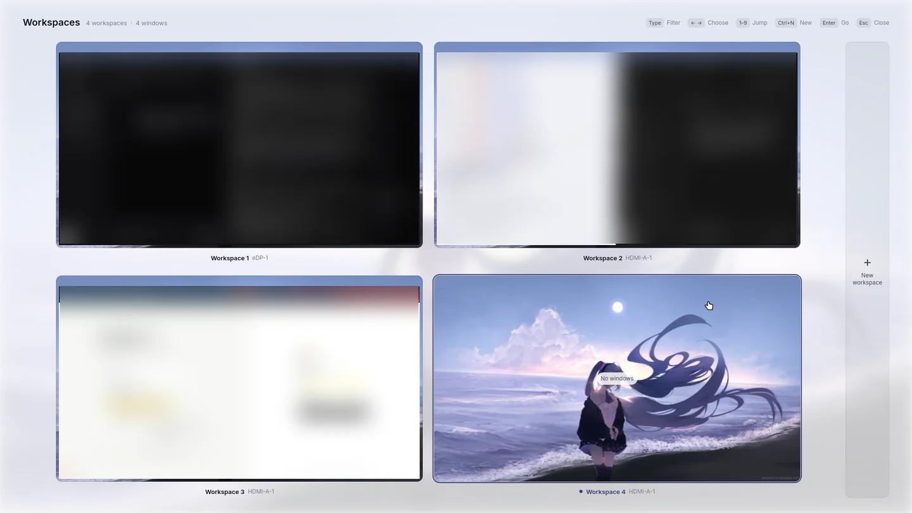 **Overview** · every workspace at once, drag-to-move, type-to-filter & live Alt+Tab thumbnails |
| 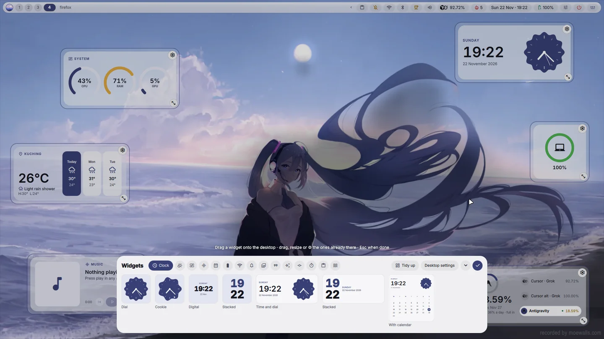 **Widgets** · 10 widget kinds including AI usage, network, photo, quote & system with snap alignment guides | 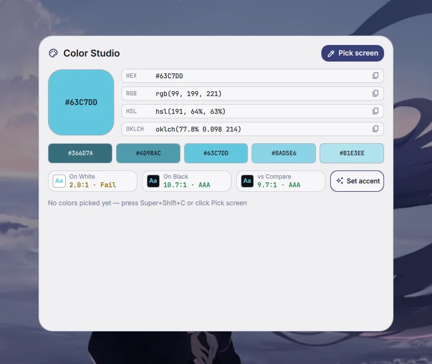 **Color Studio & Notes** · eyedropper history, HEX/RGB/HSL/OKLCH, WCAG contrast, Set Accent & markdown scratchpad |

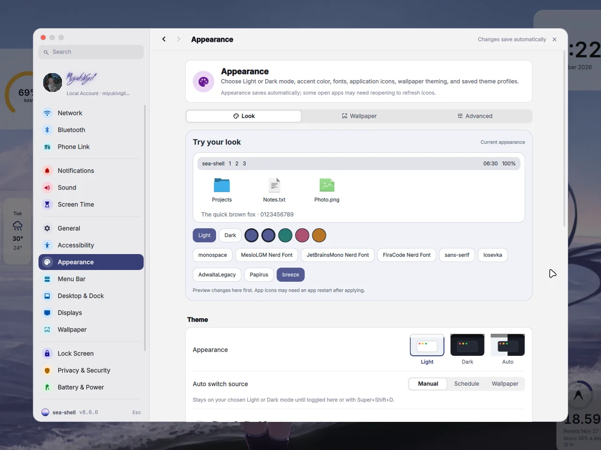
**Control center** (`SUPER+S`) · 34 lazy-loaded pages with search, favourites, live previews, disk
cleaner, needs-attention health alerts, and changes that apply as you make them.

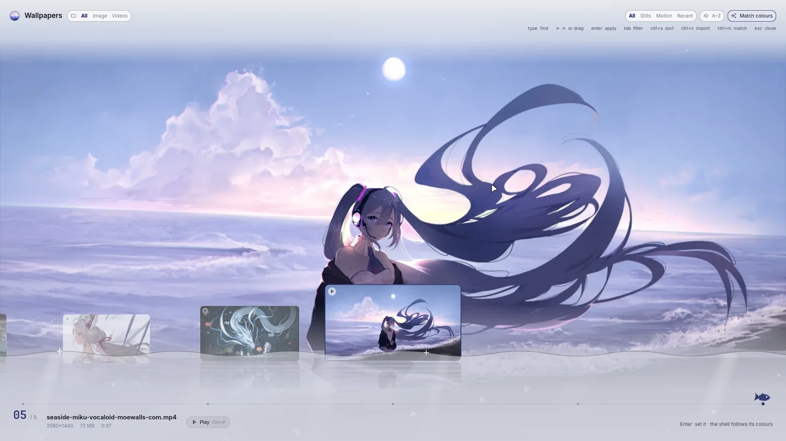
**Your wallpaper picks the colours.** Reworked tide-pool wallpaper picker (`SUPER+SHIFT+W`) with
animated water reflection, Stills/Motion/Recent filters, quick bottom wallpaper strip (`SUPER+N`),
day/night pairs, and VAAPI-optimized video wallpapers — while matugen recolours the bar, panels,
widgets, GTK/Qt apps, kitty and logo to match.

Also in the box: five **native Rust apps & daemons** (`sea-files` GTK4 file manager with AppImage
installer, `sea-appmenu` global menu, `sea-fand` fan curve daemon, `sea-gamepad`, `sea-panel`),
a **dock**, **Alt+Tab live-thumbnail window switcher**, **Workspaces Expose** (drag-to-move +
type-to-filter), **per-monitor desktop setups**, **Enterprise Wi-Fi (802.1X / eduroam)** &
**Wi-Fi join QR**, **Big Picture & dedicated `sea-shell Gaming` session** (Steam, Heroic, Lutris,
Twintail, Prism), **two-tier Game Mode** (Smart Hibernate + Ultra Zero-Shell suspend), **DevHub**
(GitHub contributions, AI usage plans, live localhost ports & systemd services), **Totem 2FA**,
**visual clipboard & emoji picker**, **scratchpad markdown notes**, **drop shelf & instant LAN QR
share**, **Color Studio**, **workspace app sessions**, **screen ruler**, **OCR & instant
translate**, screenshots with an editor (redact, step badges, pin-to-screen), a screen recorder,
**per-app audio mixer**, **hybrid dGPU wake monitor**, synced lyrics, focus profiles, over-the-air
updates with rollback, a health check (`sea-check.sh`) and backups. No waybar, rofi, mako or
swaync needed.

## Keys

| | |
|---|---|
| `SUPER+Space` | Launcher (apps, windows, math, base/unit/tz conversions, `:kill`, `#hex`, `g`, `gh`, `!note`) |
| `SUPER+D` | Dashboard (Overview · Gaming · Dev) |
| `SUPER+S` | Control center |
| `SUPER+E` | Files (`sea-files` native Rust/GTK4) |
| `SUPER+ESC` | Power menu (hold to confirm · UEFI · Big Picture) |
| `SUPER+W` | Workspaces overview (type to filter & jump) |
| `SUPER+V` / `SUPER+.` | Visual clipboard history & pins / Emoji & symbols picker |
| `SUPER+SHIFT+G` | Game mode (Smart Hibernate or Ultra Zero-Shell) |
| `SUPER+SHIFT+S` / `SUPER+SHIFT+T` | Screenshot editor (redact, step badges, pin) / OCR & translate |
| `SUPER+ALT+N` / `SUPER+ALT+C` | Scratchpad markdown notes / Color Studio |
| `SUPER+ALT+S` / `SUPER+ALT+L` | File drop shelf & QR share / Workspace app sessions |
| `SUPER+ALT+P` / `SUPER+ALT+F` / `SUPER+ALT+R` | Picture-in-Picture snap / Focus float / Screen ruler |
| `SUPER+SHIFT+A` / `SUPER+SHIFT+W` | Arrange desktop widgets / Wallpaper picker |
| `SUPER+K` | Every other bind, and click one to rebind it |

## Install options

```bash
./install.sh               # packages, then configs
./install.sh --no-deps     # configs only, any distro
./install.sh --dev         # symlink to this repo while you tinker
./install.sh --uninstall   # remove it and restore what it replaced
```

Hyprland needs a Lua config (`~/.config/hypr/hyprland.lua`); see
[hypr/README-lua.md](hypr/README-lua.md) to move over from `hyprland.conf`. Every file the
installer touches is backed up first.

## Credits

Built by [MiyukiVigil](https://miyukivigil.tech), on top of:

- **[SilentSDDM](https://github.com/uiriansan/SilentSDDM)** by uiriansan, the login screen.
  Installed as `sea-silent` with sea-shell's own config; fetched from upstream at install time
  and kept under its GPL-3.0 licence.
- **[Quickshell](https://quickshell.org/)**, the toolkit the shell is written in.
- **[Hyprland](https://hypr.land/)**, the compositor.
- **[matugen](https://github.com/InioX/matugen)**, wallpaper to palette.

For EQ and DAC control, see [Hub Moon](https://hubmoon.miyukivigil.tech/).

## Licence

[MIT](LICENSE).
